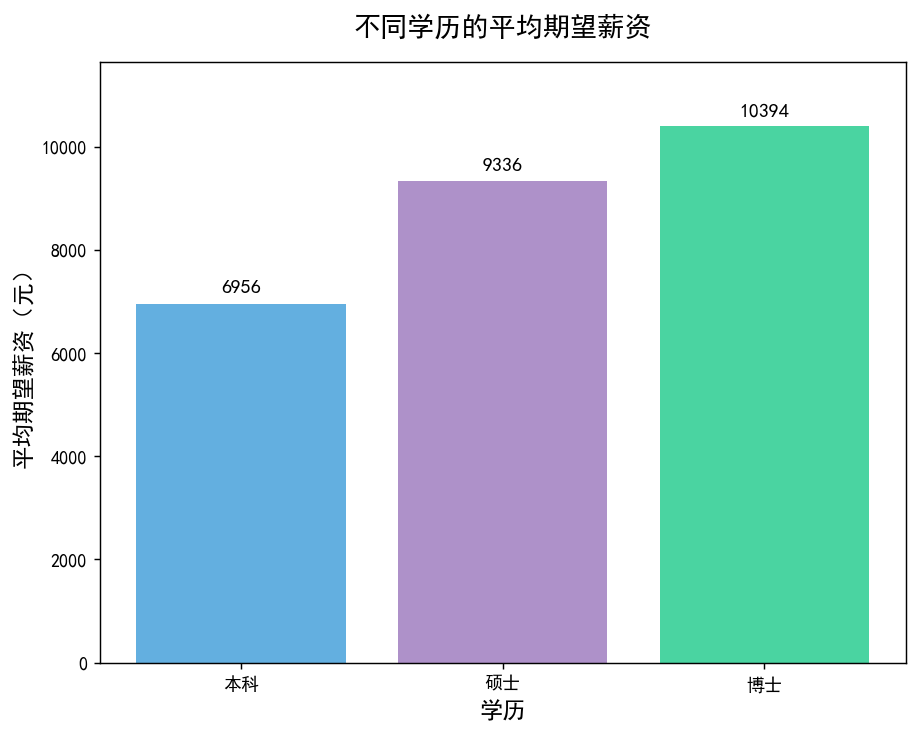
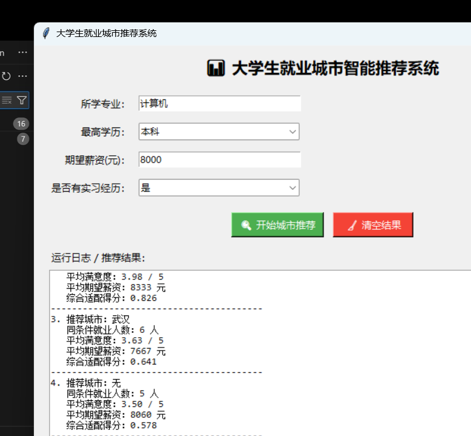
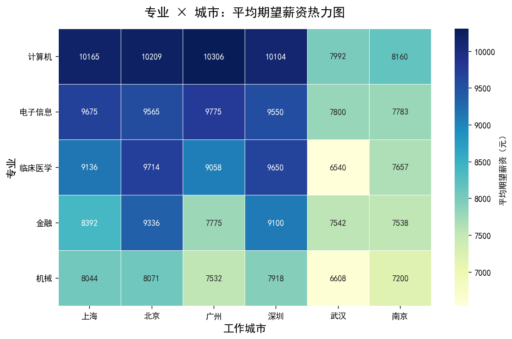

# job-analysis · 招聘岗位数据分析

> 用 Python 对**招聘岗位 / 就业调查数据**做完整分析（两套数据源共用同一条流水线）：**清洗 → 多维度统计 → 显著性检验（95% 置信区间 / p 值 / 效应量）→ 可视化 → 自动生成报告**，并附一个基于样本做城市**描述性排序**的小工具。
>
> 分析内核之外还有两层：**MySQL 8 数据层**（ODS / DWD / ADS 三层建模，装载带阻断式数据质量门禁）与 **Power BI 呈现层**（模型、DAX 度量值与报表设计成文）。SQL 与 BI 只消费分析结果，**不重算对外数字**。
>
> **默认数据源是项目自采的 Boss 直聘岗位数据**（`scripts/crawl_boss.py` 低频抓取 → `src/sources/boss.py` 适配成 7 列分析契约；采集口径、字段映射与已知限制见 [`docs/data_source_boss.md`](docs/data_source_boss.md)）。问卷 CSV 仍是可用的第二套数据源，但只能通过 `--data` 显式指定，不参与自动探测 —— 外部塞进工作区的数据不能悄悄变成项目默认输入。
>
> **English** — An end-to-end, reproducible pipeline for job-posting and graduate-employment data: cleaning → multi-dimensional statistics → significance testing (95% CI, p-values, effect sizes) → charts → auto-generated Markdown report. It also ships a MySQL 8 warehouse layer (ODS/DWD/ADS with blocking data-quality gates, views and analytical queries) and a Power BI presentation guide, plus a Tkinter tool that *ranks* cities descriptively. Synthetic demo data ships with the repo, so one command reproduces the whole pipeline. **This README deliberately contains no result numbers** — every figure lives in the generated `output/report.md`, and a test enforces that.
>
> **这个仓库不预置任何结论，也不做任何预测。** 报告里的每个数字（样本量、均值、差值、置信区间、p 值、判定）都由当次运行从数据算出；README 不复述任何一次运行的结果，避免出现与数据脱钩的「预设结论」。

[](https://github.com/lnl-6/job-analysis/actions/workflows/ci.yml)



---

## 一、这个项目解决什么问题

网上关于「哪个专业好就业」「要不要实习」的讨论大多是拍脑袋。
本项目把一份就业调查数据做成**可复现的分析流程**：

- 输入端：一份 CSV（7 个必需字段：学历 / 专业 / 期望薪资 / 满意度 / 实习经历 / 毕业去向 / 工作城市）
- 处理端：无效值剔除 → 缺失值填充 → IQR 异常值剔除 → 多维度分组统计 → **成对比较与显著性检验**
- 存储端：**MySQL 8 三层建模**（ODS 原始不改一字 / DWD 清洗明细 + 维表 / ADS 结果表），装载带阻断式门禁
- 输出端：**一张可读的报告 + 9 张图表**（交叉热力图在无样本或样本不足时自动留空）+ 供 SQL 与 Power BI 直接消费的结果表
- 呈现端：**Power BI**（关系模型 + 可直接粘贴的 DAX 度量值 + 三页报表设计，见 [`docs/powerbi.md`](docs/powerbi.md)）

**三条硬规则**（贯穿代码、报告与 CI）：

1. **不预置结论**：结论不是写死的字符串——报告里的每个数字都由当次运行算出（`src/stats.py` + `src/analysis.py`）。
2. **样本不足不给结论**：任一组低于最小样本量门槛就只报样本量、不报「差异」；阈值集中在 `src/config.py`，并由报告如实打印。
3. **不做预测**：只输出「这批样本里两组差多少、有多不确定」，不预测个体结果、不预测未来。

---

## 二、快速开始

**环境要求**：Python ≥ 3.10（开发环境为 3.14）；依赖见 `requirements.txt`（含 `scipy`，显著性检验用）；图形界面使用标准库 `tkinter`（Linux 上需要额外安装 `python3-tk`）。

```bash
# 1. 安装依赖
pip install -r requirements.txt

# 2. 准备数据（二选一）
#    a) 真实数据：抓 Boss 岗位 → 适配成分析 CSV（需登录后的 Cookie；抓取产物不入库）
$env:BOSS_COOKIE = "lastCity=101010100; __zp_stoken__=..."
python scripts/crawl_boss.py --query 数据分析 --city 北京,上海 --rounds 3 --to-csv
#    b) 离线跑通：用仓库自带的合成演示数据（无需 Cookie）
python scripts/generate_demo_data.py

# 3. 跑完整分析（默认数据源：data/raw/boss_岗位数据集.csv → 演示数据兜底）
python main.py
python main.py --data data/raw/大学生就业数据.csv    # 想用问卷 CSV 时必须显式指定

# 4. 运行测试（两种方式等价，pytest 需要先装 requirements-dev.txt）
python tests/test_pipeline.py      # 27 项：分析内核
python tests/test_sql_layer.py     # 11 项：SQL 数据层（用 SQLite 镜像，无需 MySQL）
python tests/test_source_boss.py   # 18 项：Boss 岗位数据适配层（离线样例，不联网）
pytest -q tests/

# 5.（可选）装载进数据层并跑门禁与查询
#    没有 MySQL 时走 SQLite 镜像；有 Docker 时走 MySQL 8
python scripts/load_to_mysql.py --backend sqlite --query 01_top_n_cities_by_major
docker compose up -d mysql && python scripts/load_to_mysql.py --backend mysql \
    --user root --password employment --database employment_analysis
```

跑完会在 `output/` 下得到：

```
output/
├── report.md                      # 完整分析报告
├── 01_学历_平均期望薪资.png
├── 02_学历_平均满意度.png
├── 03_实习经历_薪资分布.png
├── 04_专业_平均薪资TOP.png
├── 05_毕业去向_平均薪资.png
├── 06_毕业去向_满意度分布.png
├── 07_城市_平均薪资.png
├── 08_一线vs新一线_薪资.png
└── 09_专业城市_薪资热力图.png
```

### 命令行参数

| 参数 | 说明 |
|---|---|
| `--data <路径>` | 指定数据文件（默认自动探测真实/演示数据） |
| `--check-data` | **只检查数据文件**：列名/类型/缺失值，不跑分析 |
| `--no-charts` | 只算数不出图（适合服务器环境） |
| `--top N` | 专业维度取前 N 名，默认 5（报告标题与交叉分析会同步跟着变） |

### 图形界面（附加模块）

```bash
python gui.py
```

输入专业 / 学历 / 期望薪资 / 实习经历，得到按「综合适配得分」排序的城市推荐。



---

## 三、数据说明

⚠️ **仓库自带的 `data/raw/demo_大学生就业数据.csv` 是合成演示数据**，由 `scripts/generate_demo_data.py` 按固定随机种子生成，仅用于让项目 clone 后可直接运行。

它属于**模拟场景**：脚本里的每一张系数表（学历基准、城市系数、专业系数、实习/去向乘数、缺失与异常值注入比例）都公开登记在 [`data/README.md`](data/README.md)，可用 `python scripts/generate_demo_data.py --show-params` 打印核对。脚本还提供 `--scenario null`（把所有分组效应压成中性值）作为**校准对照**，用来验证管线不会在「本来没有差异」的数据里报出「差异显著」。

**所有基于演示数据的结论不得用于真实引用**：报告里的数字是程序从这份模拟数据里测出来的，不是现实结论。

问卷 CSV 不再自动加载：把它放到 `data/raw/大学生就业数据.csv` 后，用 `python main.py --data data/raw/大学生就业数据.csv` 显式指定（报告里仍会标注数据性质）。**这一份默认不入库**（`.gitignore` 已排除）：仓库里带的始终是合成演示数据，真实数据只留在本地；若要连数据一起发布，请先确认它允许再分发。字段说明见 [`data/README.md`](data/README.md)。

> **数据来源、样本量、采集时间请务必登记在 `data/README.md` 中。**
> 没有来源标注的数据，结论不可信、也不可被引用——本仓库自带的只是合成演示数据。

### 默认数据源：Boss 直聘岗位数据

数据源不止问卷一种。`src/sources/boss.py` 把 Boss 直聘的岗位 JSON 适配成同一套 7 列分析契约（清洗、统计、体检、报告全部复用），`scripts/crawl_boss.py` 负责低频抓取（原始 JSON 落盘、支持断点续爬、只礼敬不对抗）。**口径不同，所以必须显式声明**：

| 契约列 | 问卷数据 | 岗位数据 |
|---|---|---|
| `期望薪资` | 受访者期望月薪 | 岗位薪资区间中值（元/月） |
| `满意度评分` | 受访者满意度 | 岗位吸引力**代理分**（0~5，非满意度） |
| `专业` | 所学专业 | 岗位方向（按标题关键词归类） |
| `毕业去向` | 就业/考研/出国/创业/待业 | 岗位类型（实习/校招/社招） |

报告会在溯源区打印「数据口径」，所以不会分不清数字来自哪种数据。完整映射、薪资解析规则、代理分公式、合规边界与已知限制见 [`docs/data_source_boss.md`](docs/data_source_boss.md)。抓取产物 `data/raw/boss/` 与生成的数据集默认不入库（`.gitignore`）。**不联网也能跑**：

```bash
python -m src.sources.boss --raw data/raw/sample/boss_jobs_sample.jsonl \
    --out "data/raw/boss_岗位数据集.csv"
python main.py --data "data/raw/boss_岗位数据集.csv"
```

**要规模就多轮 / 多城市叠加**（默认 5 页 × 每页间隔 4 秒 + 抖动，礼敬式低频）：

```bash
# 2 个关键词 × 10 个城市 × 5 页 ≈ 单轮 1000~3000 条
python scripts/crawl_boss.py --query 数据分析,数据开发 --city 北京,上海,广州,深圳,杭州,成都,武汉,南京,西安,苏州 --pages 5

# 多轮叠加：一轮跑完等 10 分钟再刷一轮（收集新上架岗位），最多 3 轮、累计 3000 条上限
python scripts/crawl_boss.py --query 数据分析,数据开发 --city 北京,上海,广州,深圳,杭州,成都,武汉,南京,西安,苏州 --pages 5 --rounds 3 --round-wait 600 --max-jobs 3000
```

`--rounds` 的语义是「同一批关键词 × 城市再刷几遍」，不是把页数翻倍；去重由适配层按 `job_id` 做，重复抓到的岗位不会进数据集。样本量 <30 的分组一律不给结论，所以 20~30 条的样例只能跑通流程、看不到有意义的统计。

---

## 四、技术栈与选型理由

| 技术 | 为什么用它 |
|---|---|
| **pandas** | 表格数据的事实标准，groupby/agg 表达能力足够 |
| **matplotlib + seaborn** | 静态图输出稳定，`savefig` 可直接进 README；seaborn 只用于箱线图，减少依赖复杂度 |
| **numpy** | 构造演示数据的分布采样；统计计算的基础数组 |
| **scipy** | 显著性检验与区间估计（Welch t 检验、Mann-Whitney U、t 分布分位数、Spearman 秩相关）——统计量交给成熟实现，不手搓公式 |
| **MySQL 8** | 数据层：ODS/DWD/ADS 三层建模，窗口函数 / CTE 做分析型查询；列级 `COMMENT` 是数据字典的单一来源 |
| **SQLite** | 同一批 `.sql` 的零依赖镜像（`sql/schema_sqlite.sql`）：没有 MySQL 的机器也能验证 SQL 逻辑与门禁，CI 里也用它 |
| **PyMySQL** | 纯 Python 驱动，不需要本地编译工具链 |
| **Docker Compose** | 一条命令起 MySQL 8 并自动执行 schema 与视图；`Makefile` 把常用命令收成 `make test / lint / sqlite / mysql-load` |
| **Power BI** | 呈现层：只连 ADS 结果表与视图 + 维表，度量值清单见 [`docs/powerbi.md`](docs/powerbi.md) |
| **ruff** | 静态检查（配置在 `pyproject.toml`，CI 跑 `ruff check .`）；只开 `E9`/`F` 这类真问题规则 |
| **tkinter** | 标准库自带，零额外依赖，适合做轻量工具界面 |

**没有用 Jupyter**：Notebook 适合探索，但不适合交付。「能被别人一条命令跑起来」比「我这里能跑」重要得多。

---

## 五、项目结构

```
.
├── main.py                     # 命令行入口
├── gui.py                      # 图形界面入口（附加）
├── requirements.txt            # 运行依赖（含 scipy、PyMySQL）
├── requirements-dev.txt        # 测试与检查依赖（pytest、ruff）
├── pyproject.toml              # pytest 与 ruff 配置
├── docker-compose.yml          # MySQL 8（首次启动自动执行 schema 与视图）
├── Makefile                    # make test / lint / run / sqlite / mysql-up / mysql-load / mysql-down
├── .env.example                # 数据库连接示例（.env 已被 gitignore）
├── LICENSE                     # MIT
├── src/
│   ├── config.py               # 路径、列名常量、阈值、中文字体探测
│   ├── loader.py               # 数据加载 + 结构校验 + 来源标注
│   ├── cleaner.py              # 无效值剔除 + 缺失值填充 + IQR 异常值剔除（含不变量断言）
│   ├── stats.py                # 统计推断：均值差/95% CI/Welch t/Mann-Whitney/Cohen's d/秩相关/Holm
│   ├── analysis.py             # 纯统计计算，返回结构化结果（含 comparisons / group_stats / quality）
│   ├── quality.py              # 数据质量体检：缺失/重复/取值集中度/组间解释力（eta²）
│   ├── db.py                   # 数据层：ODS/DWD/ADS 三层装载 + 幂等 upsert + 阻断式门禁（MySQL / SQLite 双后端）
│   ├── viz.py                  # 可视化，全部 savefig
│   ├── report.py               # 由算出的结果生成结论 + markdown 报告（含溯源信息）
│   ├── recommender.py          # 城市描述性排序（归一化加权 + 样本量门槛 + 权重敏感性）
│   └── sources/
│       └── boss.py             # Boss 直聘岗位数据 → 7 列分析契约（薪资解析 / 方向归类 / 代理分 / 经验与规模序数 / 薪资带宽 / 发布时间归一 / 详情页解析 / 多值字段）
├── sql/
│   ├── 00_schema.sql           # MySQL 8 权威 schema：15 张表，列级 COMMENT 即数据字典来源
│   ├── schema_sqlite.sql       # 列名完全一致的 SQLite 镜像（本地零依赖验证）
│   ├── 01_views.sql            # 7 个视图：长表 / 分位数 / 组内占比 / 看板视图 / 最新运行
│   ├── 02_job_market.sql       # 岗位市场层：岗位事实表 + 公司/技能维表 + 技能/福利桥表 + 5 个岗位视图
│   ├── schema_job_sqlite.sql   # 上面那份的 SQLite 镜像（同表同列同视图）
│   ├── quality_checks.sql      # 17 项阻断式门禁（单结果集，违规即退出码 1）
│   └── queries/                # 5 个分析型查询：分组 TOP-N / 分位数交叉核对 / 帕累托 / 全局基准 / 透视
├── scripts/
│   ├── generate_demo_data.py   # 合成演示数据生成器（effects / null 两个场景，参数全部公开）
│   ├── crawl_boss.py           # Boss 直聘低频抓取（原始 JSONL 落盘、断点续爬、礼敬式延迟）
│   └── load_to_mysql.py        # 把一次分析装载进 MySQL / SQLite（含门禁与查询）
├── tests/
│   ├── test_pipeline.py        # 27 项：清洗不变量（含无效薪资剔除）/ 统计性质 / 样本量门槛 / 数据质量体检 / Holm 校正 / null 场景校准 / README 无预置数字
│   ├── test_sql_layer.py       # 11 项：三层装载 / 幂等 / 岗位市场层 / 带数据重引导（DROP 顺序）/ 占位城市归一 / 门禁两道防线 / SQL 常量不漂移
│   └── test_source_boss.py     # 17 项：薪资解析（K/千/万/日薪/面议/13 薪）/ 方向归类 / 代理分边界 / 经验与规模序数 / 薪资带宽 / 发布时间归一 / 多值拆分 / 扩展列填充 / 详情页解析 / 离线 manifest / 7 列契约 / 去重 / 样例端到端跑通分析
├── legacy/
│   ├── top_v0_original.py      # 重构前的 411 行单文件原版（仅存档，勿直接运行）
│   └── README.md               # 「原版问题 → 新版做法」逐条对照
├── docs/
│   ├── metrics.md              # 指标口径对照（Python vs SQL）与改口径的规矩
│   ├── data_dictionary.md      # 字段级数据字典（分层、主键、约束、视图、门禁）
│   ├── powerbi.md              # Power BI：模型关系、DAX 度量值清单、三页报表设计
│   ├── data_source_boss.md     # Boss 岗位数据源：字段映射、薪资解析、代理分公式、合规与已知限制
│   └── images/                 # 供 README 引用的图表与界面截图（已入库）
├── .github/workflows/ci.yml    # CI：ruff + 测试 + 全流程 + GBK 回归 + null 校准 + SQLite 装载 + MySQL 8 job
├── data/
│   ├── README.md               # 字段说明 + 数据来源登记 + 模拟场景参数表 + 岗位数据口径
│   └── raw/
│       └── sample/             # Boss 岗位手工样例（29 行，供离线跑通与测试）
└── output/                     # 运行产物（已 gitignore）
```

**为什么拆模块**：分析逻辑（`analysis.py`）与展示逻辑（`viz.py`/`report.py`）分离，才能对前者单独写测试。

**为什么 `docs/images/` 单独存在**：`output/` 是运行产物、不入库，但 README 首屏必须有图。所以把关键图表单独提交一份到 `docs/images/`，README 引用它，避免 clone 之前就是裂图。

---

## 六、数据层与呈现层（MySQL 8 + Power BI）

分析内核之外，这个项目还把结果做成**能被 SQL 与 BI 消费**的数据层：

```
CSV ─► loader ─► cleaner ─► analysis / stats / quality ─► ADS 结果表 ─► Power BI
                      │                │
                      └── src/db.py ───┘   ODS（原始不改一字）+ DWD（清洗明细 + 5 张维表）+ ADS（结果）
```

- **三层建模**：ODS 保留原始字符串（随时能回头核对「这条记录原样是什么」）；DWD 是清洗后的明细 + 维表，带 5 个外键和 2 个 `CHECK` 约束；ADS 是当次运行的结果表（分组统计、假设检验、交叉矩阵、质量体检、权重敏感性、溯源）。
- **一条命令装载**：`python scripts/load_to_mysql.py`（`--backend mysql` / `--backend sqlite`，后者用 `sql/schema_sqlite.sql` 的零依赖镜像，不需要装任何数据库）。
- **阻断式门禁**：装载完自动跑 `sql/quality_checks.sql` 的 17 项检查（行数守恒、非正薪资、满意度越界、占位城市泄漏、小样本均值泄漏、`significant` 与样本量一致、岗位薪资解析覆盖率、技能桥表孤行……）。`severity = '阻断'` 的项只要有 1 条违规就以退出码 1 结束——**数据没通过校验，看板就不该刷新**。
- **能力证明的 5 个查询**（`sql/queries/`）：分组 TOP-N（CTE + `ROW_NUMBER`）、分位数交叉核对（SQL nearest-rank vs Python 线性插值）、帕累托累计占比、组内均值 vs 全局基准偏离、条件聚合透视。
- **口径文档**：[`docs/metrics.md`](docs/metrics.md) 回答「同一个指标在 Python 与 SQL 里分别怎么算、谁说了算、怎么核对」；[`docs/data_dictionary.md`](docs/data_dictionary.md) 是字段级字典；[`docs/powerbi.md`](docs/powerbi.md) 给 BI 的模型关系、DAX 清单与报表设计。
- **二次分析也在门禁之内**：数据库与 BI 都不重算对外指标，只消费分析层的结论——所以看板上的数字和报告里的数字天然一致。

本地起库与装载：

```bash
cp .env.example .env
docker compose up -d mysql      # 首次启动自动执行 sql/00_schema.sql 与 sql/01_views.sql
python scripts/load_to_mysql.py --backend mysql --user root --password employment \
    --database employment_analysis --query 01_top_n_cities_by_major
```

没有 Docker 也能验：`make sqlite` 用 SQLite 镜像跑同一批查询与门禁（CI 里就是这么验的）；MySQL 那一条链路由 CI 的 `mysql` job（`mysql:8.0` service container）持续验证。

---

## 七、结果从哪来（本仓库不预置结论）

**这里不写任何具体数字**——写了就会变成「与数据脱钩的预设结论」。跑一条命令，结果全部落在报告里：

```bash
python main.py          # → output/report.md
```

报告里每个数字都能追溯到「由什么算出」：

| 报告里的内容 | 由什么算出 |
|---|---|
| 数据指纹（SHA-256 前 12 位）/ 规模 / 阈值 / 环境版本 / 生成时间 | `src/report.py::provenance_lines` |
| 样本量 / 均值 / 中位数 / 均值的 95% 置信区间 | `src/stats.py::describe` |
| 两组均值差 + 95% 置信区间 | `src/stats.py::compare`（Welch–Satterthwaite 自由度） |
| Welch t 检验、Mann-Whitney U 检验、Cohen's d | `src/stats.py::compare`（scipy 实现） |
| 「差异显著 / 不显著 / 样本不足」的判定 | `src/stats.py::Comparison.verdict`（判定只有这一处，报告不另下判断） |
| 某维度对指标的「组间解释力」eta² 与 ANOVA p 值 | `src/quality.py::group_effect` |
| 缺失率 / 重复行 / 取值集中度 / 薪资分布形态 | `src/quality.py::audit` |
| 多组对比的 Holm 校正后 p 值 | `src/stats.py::holm_adjust`（同一次运行的所有对比算一个检验族） |
| 城市排序的稳健性（换权重的 Spearman 秩相关） | `src/recommender.py::weight_sensitivity` |

两条自证机制（不是嘴上说说，CI 都会跑）：

- **样本量门槛**：任一组低于 `config.MIN_GROUP_SIZE`（默认 30）只报样本量、不给差异结论；交叉表里样本不足的格子直接留空（实测样本量单独列表）。
- **null 场景校准**：`python scripts/generate_demo_data.py --scenario null` 生成一份**按定义不含任何分组差异**的数据，拿它跑同一条管线——如果报出「差异显著」，就是假阳性。测试用固定随机种子断言「一次都不该出现」，CI 也会把这条管线跑一遍。

图表同样是运行产物（`output/` 不入库；README 引用的这份在 `docs/images/`，属示例输出，随数据/参数变化）：



---

## 八、踩坑记录

真实踩过的坑，按遇到顺序记录。**重构前的 411 行单文件原版保留在 [`legacy/`](legacy/README.md)**，第 1~5 条都能在原版里找到对应位置；第 6 条是把代码真正跑一遍才踩出来的；第 7 条是「能不能经得起追问」这一关暴露出来的——数据可以是模拟的，但结论不能是预设的。

### 1. matplotlib 的中文显示成方块

**现象**：图里所有中文标题、坐标轴标签都变成 □□□□。
**原因**：matplotlib 默认字体不含中文字形。
**解决**：显式指定中文字体，并关闭 `unicode_minus`（否则负号也会变方块）。

```python
plt.rcParams['font.sans-serif'] = ['SimHei']
plt.rcParams['axes.unicode_minus'] = False
```

**后续改进**：直接写死 `SimHei` 在 macOS / Linux 上会失效。改为**按优先级探测已安装字体**（见 `src/config.py::setup_chinese_font`），Windows / macOS / Linux 都能跑。

### 2. 9 个 `plt.show()` 把 GUI 卡死

**现象**：点开程序先弹 9 个图表窗口，必须全部手动关掉，界面才出来。
**原因**：`plt.show()` 是**阻塞调用**，且在模块级直接跑了分析函数。
**解决**：全部改成 `savefig` 落盘 + `plt.close(fig)` 释放内存；数据加载与分析只在启动时做一次。图表通过 README / 报告查看，而不是弹窗。

### 3. 「综合适配得分」权重形同虚设

**原始公式**：
```python
score = 就业人数*0.5 + 平均满意度*0.3 + 平均期望薪资/1000*0.2
```

**问题**：三个指标量纲差了一个数量级以上——就业人数可能 0~100，满意度只有 0~5，薪资除 1000 后约 5~20。直接加权，**「人数」会压倒性主导，0.5/0.3/0.2 只写在代码里好看，不影响排序**。

**解决**：先对每个指标做 min-max 归一化到 `[0,1]`，再加权求和。这样权重才真正代表「我更看重哪个维度」。

相关代码：`src/recommender.py::recommend`

### 4. 结论被写死在代码里

**原始写法**：分析跑完后，直接 `print` 几行固定的结论字符串。
**问题**：数据一换，结论还是那几句——这是「伪分析」，任何一次数据更新都会立刻穿帮。
**解决**：所有结论由 `report.build_conclusions()` **从 DataFrame 实时算出**。数据变了，结论自动变。

> 同一个坑还踩了第二次：报告里的「专业维度（薪资前 5）」一度也是写死的标题，跑 `--top 8` 时表里有 8 行、标题却写着前 5。现在标题由结果长度推导（`len(results["major_top"])`），CI 里也加了断言防止回退。

### 5. 编码问题导致中文列名读不出来

**现象**：`KeyError: '性别'`。
**原因**：CSV 存成了 GBK，而 `read_csv` 默认按 UTF-8 解析。
**解决**：加 `encoding='utf-8-sig'`（兼容 Excel 导出的 BOM），并在 `UnicodeDecodeError` 时回退到 `gbk`。

### 6. Windows 中文控制台把整个流程跑崩

**现象**：在 Windows 的 cmd / PowerShell（默认代码页 GBK）里跑 `python main.py`，图表全画完了，`[5/5] 生成报告` 却一直没出现——报告根本没落地：

```
Traceback (most recent call last):
  ...
  File "src\report.py", line 243, in print_console_report
    print("⚠️  当前使用的是【合成演示数据】，结论不可用于真实引用！")
UnicodeEncodeError: 'gbk' codec can't encode character '\u26a0' in position 0: illegal multibyte sequence
```

**原因**：控制台打印的字符串里带了 `⚠️`（U+26A0）。中文在 GBK 里编得出来（列名、城市名、图表文件名都没事），**emoji 编不出来**；而 `print` 抛出的编码异常会直接终止进程，不像写文件那样容易被忽略。分析、图表全算完了，最后一步写报告却没执行。

**为什么 CI 没发现**：GitHub Actions 的 Linux runner 一律 UTF-8，这条路径永远走不到。这类 bug 只有「在目标平台真的跑一次」才会暴露。

**解决**：两件事——

1. 控制台输出不再用 emoji，改成纯文本标记（`src/report.py:243` 的 `⚠️` → `[!]`）；报告 markdown 里的 `⚠️` 保留（写文件是 UTF-8，GitHub 上渲染正常）。
2. 入口加编码兜底，万一以后又混进编不出来的字符，只是显示成 `?`，而不是让整轮分析白跑：

```python
# main.py::make_console_safe()
for stream in (sys.stdout, sys.stderr):
    try:
        stream.reconfigure(errors="replace")
    except (AttributeError, ValueError, OSError):
        pass  # 被重定向/包装过的流没有 reconfigure，忽略即可
```

**回归测试**：CI 里补了一步等价复现——在 Linux 上强制按 GBK 编码跑一遍完整流程：

```bash
PYTHONIOENCODING=gbk python main.py --top 8
```

### 7. 「分析结论」其实是生成器常数的回声

**现象**：报告看着很专业——学历、城市、专业三组差异都「显著」，方向也符合直觉。但那是**必然**的：演示数据的薪资就是按 `EDU_BASE_SALARY × CITY_MULTIPLIER × MAJOR_MULTIPLIER` 构造出来的，结论等于把脚本里的常数表再念一遍。用这种数据讲「我发现学历影响薪资」，被追问一句「你怎么证明不是你写进去的」就答不上来。

**解决**（把「预设」和「测量」分开）：

1. **参数全部公开**：模拟数据的所有系数与注入比例登记在 [`data/README.md`](data/README.md)，并可用 `--show-params` 打印——它是**数据说明**，不是结论。
2. **结论只由测量决定**：新增 `src/stats.py`，报告只输出「均值差 / 95% 置信区间 / p 值 / 效应量 / 判定」，判定逻辑只有一处（`Comparison.verdict`）。
3. **样本不足不给结论**：门槛 30 条集中在 `src/config.py`，报告如实打印；交叉表小样本格子留空，样本量另表列出。
4. **加 null 对照场景**：把所有分组效应压成中性值再跑同一套检验——能在这个场景上「发现」差异，才说明管线有假阳性，CI 会跑这个场景。
5. **README 不复述数字**：README 里不出现任何一次运行的具体结果，就不会有与数据脱钩的预设结论；`tests/test_pipeline.py::test_readme_keeps_no_run_specific_numbers` 会拦住回退。

**顺带修掉的**：权重敏感性没人管（换一组权重重算，看 TOP1 会不会翻）、交叉表里 1 个样本的均值也会被当成「发现」、「综合适配得分」的文案把权重写死成 0.5/0.3/0.2。

> 一句话：**数据可以是模拟的，结论必须是测出来的。**

### 8. 换真实数据后暴露的三个 bug（只有真的跑才会出现）

**现象**：演示数据上测试全绿、全流程跑通；换成 1 万行真实数据后立刻炸出三件事——而且都不是「数据脏」的错，是代码的错。

1. **`AttributeError: 'numpy.ndarray' object has no attribute 'quantile'`**：分位数工具内部把序列清洗成了 numpy 数组，却仍按 pandas 的 `.quantile()` 调用——`src/stats.py::quantiles` 改成 `np.quantile`。演示数据上没暴露，是因为那条分支只在「分组样本量达到门槛」时才会走到。
2. **`ValueError: Encountered all NA values`**：pandas 3 的 `stack()` 默认**保留**缺失值，交叉表里全空的行列会把 `idxmax()` 顶炸——先过滤 `notna()` 再取极值。同一份代码在 pandas 2 上是好的，这是升级到 pandas 3 才会遇到的坑。
3. **门禁自己误报**：`ODS 行数 = DWD 行数` 这条检查，在清洗本来就会剔除无效薪资/异常值的前提下必然失败（真实数据里有 `-2100` 这类无效值）。修法是让检查把剔除行数算进去——`ODS = DWD + rows_invalid_salary + rows_outlier_removed`——并且所有检查只看**最新一次装载**（新增 `v_latest_run` 视图），否则历史批次的脏数据会让门禁永远红着。

**教训**：演示数据是「按剧本生成的好数据」，它证明不了代码健壮，**真实数据的第一轮运行才是真正的集成测试**。顺带定了个规矩：门禁的公式与阈值写在 SQL 里，也要被测试盯住（`tests/test_sql_layer.py::test_sql_constants_match_config`），不然门禁自己会变成新的坑。

### 9. 第二次装载就崩：DROP TABLE 的顺序被外键挡住

**现象**：第一次装载一切正常；同一台机器上再装一次，直接失败：

```
[错误] IntegrityError: FOREIGN KEY constraint failed
```

**原因**：schema 脚本按「ODS → 维表 → 事实表 → 结果表」的阅读顺序写，`DROP TABLE` 也就跟着这个顺序——但事实表有外键指向维表，**删被引用的父表时数据库会拦住**：SQLite（`foreign_keys=ON`）报 `FOREIGN KEY constraint failed`，MySQL 报 `errno 3730: Cannot drop table referenced by a foreign key constraint`。

**为什么 CI 与测试都没抓到**：SQL 层测试用内存库，`ensure_schema` 连续调两次时表是空的、外键检查无事可做；CI 的 MySQL 是全新容器，也只装载一次。**「先装载、再重新引导 schema」这条路没人走过**。

**解决**：两个 schema 文件都在最前面加一段「按子表 → 父表顺序清场」的 DROP 块（视图与查询不受影响），并补一条回归测试——**先装载一次，再重新引导 schema，然后照常装载**（`test_rebootstrap_after_load_is_safe`）。这条测试修的就是「只有第二次运行才会出现」的 bug。

---

### 10. 换数据源最容易踩的坑：口径漂移

把「问卷」换成「Boss 岗位」时，**列名不变但语义变了**：`期望薪资` 从「受访者期望月薪」变成「岗位薪资区间中值」，`满意度评分` 从「受访者满意度」变成「岗位吸引力代理分」。

危险之处在于：代码一行不改也能跑通，报告数字看起来依旧「合理」，但已经把「岗位挂牌薪资」讲成了「毕业生期望薪资」——这不是 bug，是**统计口径造假**。

处理办法是四件事一起做：

1. 列名保持不动（改名会连带改动 loader / cleaner / analysis / report / viz / SQL / BI，代价远大于收益）；
2. 报告溯源区打印「数据口径」一行（`config.SOURCE_NOTES` + `report.provenance_lines`），每份报告自带口径声明；
3. 口径文档 [`docs/data_source_boss.md`](docs/data_source_boss.md) 写全字段映射、薪资解析、代理分公式与已知限制；
4. 测试守住：`tests/test_source_boss.py::test_sample_dataset_runs_through_pipeline` 断言溯源里必须出现「数据口径」与「岗位薪资区间中值」，删掉声明就红。

**教训**：换数据源不是换一个 CSV 路径，是换一套「这些列到底在测什么」。能被写进文档、能被报告打印、能被测试拦住的口径，才不算漂移。

---

## 九、局限

这份分析是**描述性统计**，请注意：

- 只说明「相关」，**不能推出因果**。例如「有实习的人薪资更高」不等于「实习导致了高薪」，也可能是家庭资源/专业本身带来的选择偏差。
- 若样本不是随机抽样，结论**不可外推到总体**。
- IQR 剔除会去掉一部分高端样本（剔除多少行由当次数据决定，见每次运行报告的「数据清洗」一节——报告不复述固定比例），会让平均薪资偏低。
- **不做预测**：本项目不含趋势外推、不含个体结果预测、也不含「该去哪」的建议；「城市排序」只是对已收集样本的描述性排序。
- **换数据源不改变推断的性质，但会改变结论的适用范围**：岗位数据是「在招岗位快照」，`n` 条岗位 ≠ `n` 个人；薪资是挂牌区间中值，不是到手薪资；「岗位吸引力代理分」不是满意度。这些边界逐条写在 [`docs/data_source_boss.md`](docs/data_source_boss.md) 第 7 节。

---

## 十、待办

- [ ] 填入真实数据与来源说明（`data/README.md`）——**这是目前最大的短板**：真实数据到位，报告才有现实意义（当前真实数据只放本地，未入库）
- [x] 补充 `tests/`：清洗不变量（含无效薪资剔除）/ 统计性质 / 样本量门槛 / 数据质量体检 / Holm 校正 / null 场景校准 / README 无预置数字（现 56 项 = 分析内核 27 + SQL 数据层 11 + 数据源适配 18）
- [x] 数据源扩展：Boss 直聘岗位数据（低频可断点续抓脚本 + 口径适配层：7 列口径契约 + 25 列扩展字段（含经验/规模序数、薪资带宽、发布时间、JD 长度）、6 个岗位方向归类、5 类薪资格式解析、详情页 JD 抓取、采集 manifest、手工样例 + 18 项离线测试 + 口径文档 + 多轮/多城市叠加采集）
- [x] 增加「专业 × 城市」交叉分析，并对样本不足的组合留空、样本量另表列出
- [x] 统计推断层 `src/stats.py`：95% 置信区间 + Welch t 检验 + Mann-Whitney U + Cohen's d + Holm 多重比较校正
- [x] 城市排序：样本量门槛 + 权重敏感性（Spearman 秩相关）
- [x] 数据层 `src/db.py` + `sql/`：ODS/DWD/ADS 三层建模、7 个视图、5 个分析型查询、17 项阻断式门禁（含 4 项岗位门禁；MySQL 8 与 SQLite 双后端）
- [x] 工程外壳：`docker-compose.yml` + `Makefile` + `pyproject.toml`（pytest / ruff）+ `.env.example`，CI 增加 `mysql:8.0` service container job
- [x] 文档：指标口径（[`docs/metrics.md`](docs/metrics.md)）、数据字典（[`docs/data_dictionary.md`](docs/data_dictionary.md)）、BI 指南（[`docs/powerbi.md`](docs/powerbi.md)）
- [ ] Power BI 桌面报表（`.pbix` + 截图）——**由你自己做**：步骤与验收清单见 [`docs/powerbi.md`](docs/powerbi.md) 第 7 节
- [ ] 把报告导出为 HTML（便于直接发链接）

## License

[MIT](LICENSE)